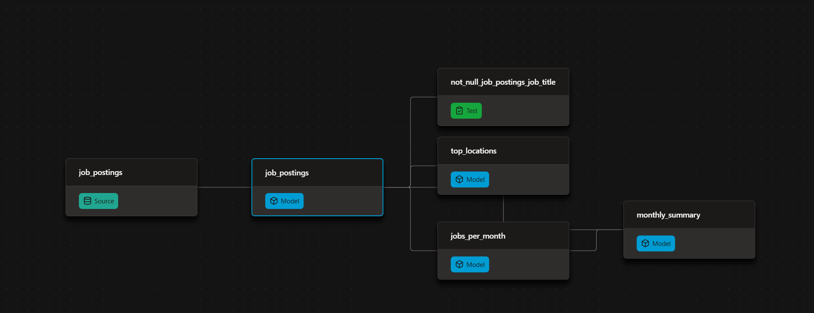

# Automated Job Postings Pipeline (v1) - dbt  + DuckDB


# dbt + DuckDB Analytics Pipeline


A public dbt + DuckDB pipeline over ~692k real job postings, rebuilt and republished automatically on every push.

- Models the raw postings into tested, documented insight marts.
- Publishes the docs site and the finished warehouse — open to anyone, no credentials.
- Runs itself on GitHub Actions: every push and every Monday.

> **v1 of this pipeline** — everything free and local-friendly: DuckDB as the warehouse, GitHub Actions as the scheduler. [v2](https://github.com/lukebarousse/dbt_Analytics_Engineering_Course/blob/main/project_2) rebuilds it production-grade on Databricks.

---

## Project Overview

| **What I Built** | **How I Implemented** | **Where to Look** |
|---|---|---|
| **dbt pipeline** | Sources → cleaned models → insight marts | [`analytics/`](https://github.com/Lakshmicharanreddy/dbt-duckdb-pipeline/tree/master/analytics) |
| **Data tests** | `unique` / `not_null` on every mart grain | [`schema.yml`](https://github.com/Lakshmicharanreddy/dbt-duckdb-pipeline/blob/master/analytics/models/schema.yml) |
| **dbt documentation** | Lineage, descriptions, and column tests | [`analytics/models/`](https://github.com/Lakshmicharanreddy/dbt-duckdb-pipeline/tree/master/analytics/models) |
| **Public CI** | Build + test + publish on every push | [GitHub Actions](https://github.com/Lakshmicharanreddy/dbt-duckdb-pipeline/tree/master/.github/workflows) |
| **Environments** | Local `dev` vs CI `prod` targets | [`ci/profiles.yml`](https://github.com/Lakshmicharanreddy/dbt-duckdb-pipeline/blob/master/ci/profiles.yml) |
| **Published warehouse** | DuckDB database published through GitHub Releases | [Latest Release](https://github.com/Lakshmicharanreddy/dbt-duckdb-pipeline/releases) |

---

## ⚙️ The dbt Pipeline

Raw job postings flow through three dbt layers:

1. **Sources** – Declare the raw job postings dataset.
2. **Staging** – Clean and prepare the raw data using staging views.
3. **Insight Marts** – Transform cleaned data into analytical tables.

The pipeline uses tests to validate the data before completing each build.

**dbt DAG:**



### dbt Features Used

| **dbt Feature** | **Implementation** |
|---|---|
| Declared sources | [`sources.yml`](https://github.com/Lakshmicharanreddy/dbt-duckdb-pipeline/blob/master/analytics/models/sources.yml) and `source('raw', 'job_postings')` |
| Model dependencies | `ref()` connects downstream models and allows dbt to determine execution order and parallelism. |
| Materializations | Project default: `table`; staging models: `view`. |
| Data tests | `unique` and `not_null` tests on mart grains in [`schema.yml`](https://github.com/Lakshmicharanreddy/dbt-duckdb-pipeline/blob/master/analytics/models/schema.yml). |
| Environments | Separate local `dev` and CI `prod` targets using [`ci/profiles.yml`](https://github.com/Lakshmicharanreddy/dbt-duckdb-pipeline/blob/master/ci/profiles.yml). |

The `dbt build` command compiles SQL, materializes models, and executes data tests. If a test fails, the build reports the failure.

---

## 🚀 Production Automation

GitHub Actions automates the entire pipeline without requiring a local machine.

[View GitHub Actions workflows](https://github.com/Lakshmicharanreddy/dbt-duckdb-pipeline/tree/master/.github/workflows)

### Workflow Triggers

| **Trigger** | **What Happens** |
|---|---|
| Push to `master` | Full pipeline rebuild |
| Every Monday | Scheduled rebuild to keep the warehouse fresh |
| Manual (`workflow_dispatch`) | Run the pipeline manually from GitHub Actions |

### Pipeline Execution Steps

On every workflow run, GitHub Actions:

1. Installs project dependencies using `uv`.
2. Downloads the raw Parquet dataset.
3. Executes `dbt build` using the committed production CI profile.
4. Publishes `prod.duckdb` as a GitHub Release asset.

**GitHub Actions:** [View workflow runs](https://github.com/Lakshmicharanreddy/dbt-duckdb-pipeline/actions)

---

## 🦆 Query the Published Warehouse

The published DuckDB warehouse is publicly accessible.

You do not need to clone the repository or download the entire project.

### 1. Install DuckDB

Follow the [DuckDB installation guide](https://duckdb.org/docs/installation/).

For macOS:

```bash
brew install duckdb
```

### 2. Connect to the Published Warehouse

Open a DuckDB session and execute:

```sql
INSTALL httpfs;
LOAD httpfs;

ATTACH 'https://github.com/Lakshmicharanreddy/dbt-duckdb-pipeline/releases/download/warehouse/prod.duckdb' AS jobs;

USE jobs;

SHOW TABLES;
```

### 3. Query the Data

```sql
SELECT * FROM top_locations;

SELECT * FROM monthly_summary;
```

You can directly query the published analytical tables without downloading the database.

**Published Warehouse:** [View GitHub Release](https://github.com/Lakshmicharanreddy/dbt-duckdb-pipeline/releases)

---

## 📖 dbt Documentation

The project uses dbt's documentation functionality to generate documentation for the data models.

Generate documentation locally:

```bash
uv run dbt docs generate
uv run dbt docs serve
```

The documentation provides:

- **Data Lineage:** Visual representation of the data flow from sources to staging models and insight marts.
- **Model Descriptions:** Documentation explaining the purpose of individual models.
- **Column Descriptions:** Information about the columns in each model.
- **Data Tests:** Visibility into the tests applied to models and their columns.

---

## 💻 Run the Project Locally

### 1. Clone the Repository

```bash
git clone https://github.com/Lakshmicharanreddy/dbt-duckdb-pipeline.git

cd dbt-duckdb-pipeline
```

### 2. Install Dependencies

```bash
uv sync
```

### 3. Download the Dataset

```bash
uv run python scripts/download_data.py
```

### 4. Build the dbt Pipeline

```bash
cd analytics

uv run dbt build
```

### 5. Generate Documentation (Optional)

```bash
uv run dbt docs generate

uv run dbt docs serve
```

---

## 📁 Project Structure

```text
dbt-duckdb-pipeline/
│
├── .github/
│   └── workflows/              # GitHub Actions automation
│
├── analytics/                  # dbt analytics project
│
├── ci/
│   └── profiles.yml            # CI production profile
│
├── scripts/                    # Data download and utility scripts
│
├── src/
│   └── dbt_duckdb_pipeline/    # Python package
│
├── .gitignore
├── .python-version
├── README.md
├── pyproject.toml
└── uv.lock
```

---

## 📌 Project Reference

This repository is a dbt + DuckDB analytics engineering project built around real-world job postings.

The pipeline demonstrates how to transform raw data into tested, documented analytical models and automate the entire workflow using GitHub Actions.

**Dataset:** Approximately 692k real job postings.